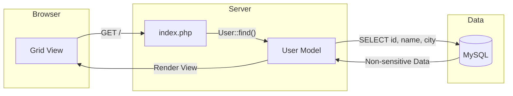
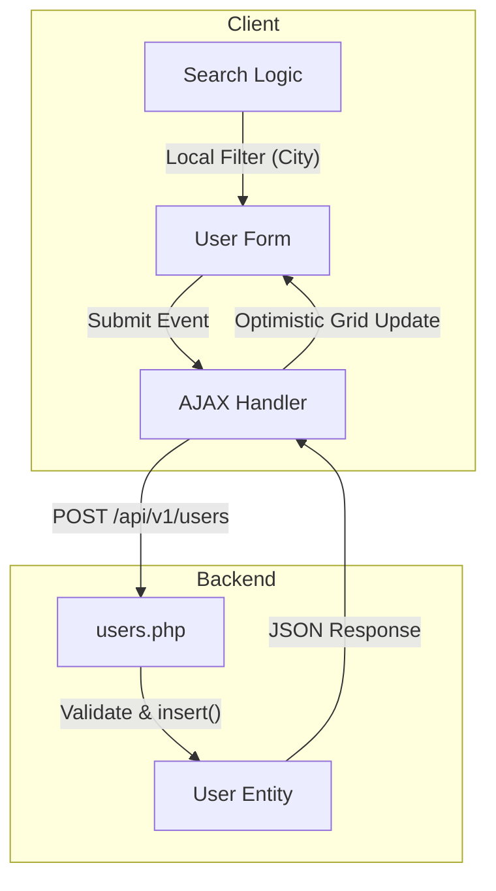
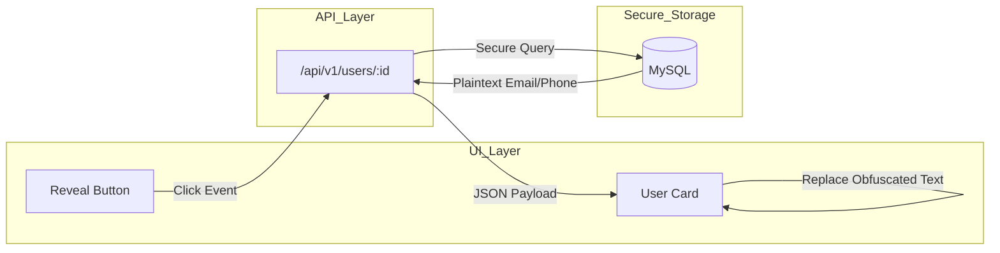
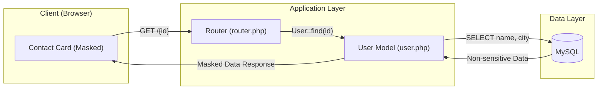

# System Design

## Assumption

The `core` framework files should not be changed, even when there is some scope for improvements, to avoid losing the originality of the framework.

## Functional Requirements

### User Management
- The system must display a list of existing users in a tabular or creative format so I will choose a grid of user cards, including their **Name**, **E-mail**, **City**, and **Phone Number**.
- The system must provide a form to create new user records.
- New records must include a phone number column in the database and the UI.

### Search and Filtering
- The system must include client-side JavaScript functionality to filter grid rows by **city**.

### Data Submission
- Form submission must be handled using **AJAX** to prevent page reloads.
- The system must validate new records before they are saved to the database.

### Data Persistence
- The system must store user data in a **MySQL** database.
- The system must record the **creation timestamp** (`created_at`) for every new record.

---

## Non-Functional Requirements

### Usability and User Experience (UX)
- The application must be styled using **Bootstrap** or **Tailwind CSS** to ensure a presentable interface.
- The user interface should be designed as a real-world product that people enjoy using, moving beyond a simple task list.
- The grid must use visual cues for readability, such as **highlighting every other row**.
- The form must use standard layouts (like Bootstrap's `form-horizontal`) for better accessibility and aesthetics.

### Performance and Efficiency
- The project should be completed within a **4-hour time limit**, requiring the developer to prioritize high-impact features.
- The developer must demonstrate the **"Two Sides" philosophy**, balancing rapid development with polished, production-ready code where it matters most.

### Scalability and Maintenance
- The code must be **"production-ready"**, implying it should be clean, modular, and follow the provided 'framework' structure.
- The system must utilize a **Model-View-Controller (MVC)** style pattern as established by the `App` and `BaseModel` classes.

### Deployment and Distribution
- The application must be deployable to a **free hosting service** with a publicly accessible production link.
- Source code must be managed in a **private GitHub repository** with specified collaborators invited.

### Security (Implicit)
- Though the provided framework uses basic escaping, **"production-ready" standards** suggest implementing robust protection against **SQL injection** and ensuring data integrity.

### GDPR Cimpliance
- We can't directly show user's personal info for bots to scrap easily so it should be either obfuscated or revealed on human user's demand.
- Right to delete personal info. for the moment in privacy policy say "email to delete/"


## Core Entities

The application revolves around a central **User** entity, which interacts with the provided `BaseModel` framework.

#### 1. User Entity

* **Properties:**
* `id` (Integer): Primary key.
* `name` (String): The user's full name.
* `email` (String): Validated email address (Sensitive Data).
* `city` (String): The user's location, used for filtering.
* `phone` (String): The newly added contact number (Sensitive Data).
* `created_at` (DateTime): Automatically generated timestamp of record creation.


* **Logic:** Managed via `models/user.php`, inheriting CRUD capabilities from `BaseModel`.

#### 2. Configuration & Database Entity

* **Database:** A wrapper around `mysqli` that handles connection persistence and raw query execution.
* **App Instance:** The singleton-style core that initializes configuration and provides the view-rendering engine.

---

### API Structure

To move toward a "production-ready" product, the API is divided into the existing submission logic and the recommended "Privacy-First" endpoints for handling sensitive data.

#### 1. User Creation API
```json
// POST /api/v1/users
{
  "name": "string",
  "email": "string",
  "city": "string",
  "phone": "string"
}
```
* **Description:** Processes new user submissions via AJAX.
* **Payload:**


* **Validation:** Must verify email format and non-empty strings before persistence.
* **Response:** JSON success/error message (recommended for AJAX) instead of a standard header redirect.

#### 2. User Collection API

```json
// GET /api/v1/users
{
  "data": [
    {
      "id": 1,
      "name": "string",
      "email": "string", // obfuscated
      "city": "string",
      "phone": "string", // obfuscated
      "created_at": "datetime"
    }
  ]
}
```
* **Description:** Though used for initial page rendering, it acts as the data provider for the table.
* **Logic:** Fetches all users via `User::find()`.

#### 3. Sensitive Data Discovery (Recommended for GDPR)

```json
// GET /api/v1/users/{id}
{
  "data": {
    "id": 1,
    "email": "string",
    "phone": "string"
  }
}
```
* **Description:** Fetches the `email` and `phone` for a specific user only when requested by the UI.
* **Purpose:** Minimizes initial data exposure in the DOM to comply with "Privacy by Design" principles.

#### 4. Search & Filter (Client-Side API)
```json
// GET /api/v1/users?filter[city]=cityName
// GET /api/v1/users?city=cityName
{
  "data": [
    {
      "id": 1,
      "name": "string",
      "email": "string", // obfuscated
      "city": "string",
      "phone": "string", // obfuscated
      "created_at": "datetime"
    }
  ]
}
```
* **Description:** A JavaScript service that intercepts the `keyup` event on the search input to filter the rendered user entities by the `city` property.

#### 5. Pagination or infinite scrolling
```json
// GET /api/v1/users?page=2&limit=20
{
  "data": [
    {
      "id": 1,
      "name": "string",
      "email": "string", // obfuscated
      "city": "string",
      "phone": "string", // obfuscated
      "created_at": "datetime"
    }
  ],
  "meta": {
    "count": 1,
    "page": 1,
    "limit": 20,
    "prev_page": null,
    "next_page": null,
    "last_page": 1
  }
}
```
* **Description:** A JavaScript service that intercepts the `scroll` event on the window to load more users when the user reaches the bottom of the page.
* **Purpose:** To reduce the amount of data loaded at once and improve performance.

#### 6. Share user's contact card
```json
// GET /{id}
{
  "data": {
    "id": 1,
    "name": "string",
    "phone": "string", // obfuscated
    "email": "string" // obfuscated
  }
}
```
* **Description:** Fetches the `email` and `phone` for a specific user only when requested by the UI.
* **Purpose:** Minimizes initial data exposure in the DOM to comply with "Privacy by Design" principles.


## High-Level Design

### 1. Initial Data Orchestration

This flow covers the server-side rendering and initial data delivery. It highlights how the `App` core interacts with the `User` model to provide the base grid data.



---

### 2. Interactive User Lifecycle (Creation & UX)

This diagram focuses on the **AJAX** submission and client-side filtering. It demonstrates the "Product Engineer" approach where the UI stays responsive without page reloads.



---

### 3. Privacy-Preserving Data Access (GDPR)

This flow encapsulates your specific GDPR requirement: keeping sensitive data out of the initial DOM and fetching it only on "human demand."
<a id="privacy-flow"></a>


### 4. User's card share

This feature, optimized to show how the system handles public profile requests while maintaining "Privacy by Design" through data masking.


This diagram illustrates how the system delivers the contact card while keeping sensitive data masked during the first request to prevent automated scraping. And then reveal phone and email on user click as shown in <a href="#privacy-flow">Privacy-Preserving Data Access (GDPR)</a>



## Deep Dive
### 1. Data Privacy & Bot Protection (GDPR Compliance)

Since the system implements a "Reveal on Demand" feature for sensitive data, a core production concern is preventing bulk data scraping.

* **Rate Limiting & Throttling**: Discuss the necessity of protecting the `/api/v1/users/{id}` endpoint. A simple implementation might use a sliding window or token-bucket algorithm to limit "reveal" requests per IP address or user session to prevent bots from harvesting the entire database.
* **Audit Logging**: For full GDPR compliance, the system should log every "reveal" event. In a production environment, you would record who accessed sensitive information (email/phone) and when, ensuring accountability for data access.
* **Server-Side Obfuscation**: Deep dive into the decision to mask data server-side rather than client-side. Server-side masking ensures that plaintext sensitive data is never transmitted in the initial HTML payload, reducing the risk of interception or browser-cache leaks.

### 2. Scaling the User Grid (Performance)

The requirement to use a grid or table for user data introduces performance bottlenecks as the dataset grows beyond a few dozen records.

* **Virtual Scrolling vs. Pagination**: If the user base reaches thousands, rendering all DOM nodes will degrade performance. You can discuss the trade-offs of **Virtualization** (rendering only what is in the viewport) versus traditional **Pagination** or **Infinite Scroll**.
* **Client-Side vs. Server-Side Filtering**: Evaluate the threshold for moving the city search from a client-side JavaScript filter to a server-side SQL `WHERE` clause. While client-side is faster for small sets, server-side is necessary to maintain low memory usage on the client as the database scales.

### 3. Hardening the Legacy Framework (Security)

The provided framework uses older patterns that require modernization for a "production-ready" label.

* **SQL Injection & Prepared Statements**: The current `BaseModel` and `Database` classes rely on basic string escaping. A critical deep dive would cover refactoring these core classes to use **PDO or MySQLi prepared statements** to eliminate SQL injection risks entirely.
* **CSRF & AJAX Security**: Since the form uses AJAX for creation, it is vulnerable to Cross-Site Request Forgery. Discuss implementing a CSRF token system where the token is generated by `App.php`, stored in the session, and verified by `create.php` during the POST request.

### 4. Frontend Resilience & State Management

High-quality product engineering requires handling the "unhappy paths" of network communication.

* **Optimistic UI Rollbacks**: When a user is added via AJAX, the UI might show the new card immediately for a "snappy" feel. The logic required to gracefully remove that card and notify the user if the backend `insert()` fails or returns a 500 error.
* **Fuzzy Search Optimization**: Implementation of a fuzzy search algorithm for the city filter. Rather than strict substring matching, using Levenshtein distance or a simple regex-based fuzzy match improves the UX when users make typos.

### 5. Observability & Production Monitoring

Transitioning from `die()` to production-level monitoring.

* **Structured Logging**: The current framework uses `die()` for database errors. In a real-world product, these should be caught and sent to a structured logging service (like Better Stack Logs) to allow for real-time alerting without exposing system internals to the end-user.
* **User Feedback Loops**: Evaluate how the API distinguishes between **Validation Errors** (422) and **System Errors** (500) to ensure the user receives actionable feedback rather than a generic "Something went wrong" message.